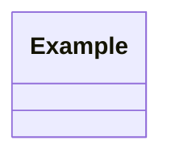

# <Topic name>

> One-sentence summary of what this pattern or problem teaches.

## 1. Problem
What are we building, and for whom? List the functional requirements as bullets
and state explicitly what is **out of scope**.

## 2. Class diagram


## 3. How it works
Walk through the main flow in a few sentences. Link to the key classes.

## 4. Design decisions
| Decision | Why |
|---|---|
| ... | ... |

## 5. Trade-offs and alternatives rejected
What else could have been done, and why it was not.

## 6. SOLID notes
Which principles the design satisfies, and what change would break them.

## 7. Known limitations
Be honest about shortcuts in the current code.

## 8. Interview follow-ups
Likely extension questions and how the design absorbs them.

## 9. Related topics
Links to neighbouring patterns and problems.

## Run it
```
mvn -q exec:java -Dexec.mainClass=<fully.qualified.EntryPoint>
mvn -q test -Dtest=<TestClass>
```

---
Rules of thumb
- Keep it to one screen of reading per section.
- Every claim about the code must be checkable in the source.
- Patterns also get a **When NOT to use it** subsection under "Trade-offs".
