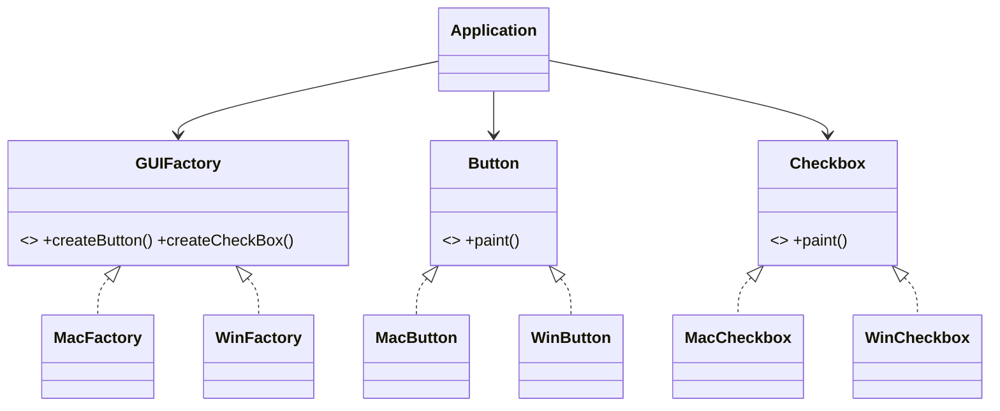

# Abstract Factory

> Create whole families of related objects that are guaranteed to belong together.

## 1. Problem
A GUI needs buttons and checkboxes, and they must match the platform. Mixing a Mac button with a Windows checkbox is a bug.

## 2. Class diagram


## 3. How it works
`EntryPoint` picks a factory from the OS string and gives it to `Application`. `Application` asks the factory for its button and checkbox and never names a platform class.

## 4. Design decisions
| Decision | Why |
|---|---|
| One factory per family | Consistency across products is enforced by construction. |
| The only `switch` is at the composition root | Business code stays platform-agnostic. |

## 5. Trade-offs and alternatives rejected
- Adding a new *family* is cheap; adding a new *product* (say `Slider`) touches every factory.
- **When NOT to use it:** there is one family, or products are not meant to be used together.

## 6. SOLID notes
**O** for new families, **D** for `Application`. A new product type breaks **O** across all factories.

## 7. Known limitations
- The OS is a hard-coded string in `EntryPoint`.

## 8. Interview follow-ups
- Add Linux? One factory and its products.
- Add a `Slider`? Update the interface and every factory.
- Read the OS from the environment?

## 9. Related topics
[Factory](../factory/README.md)

## Run it
```
mvn -q exec:java -Dexec.mainClass=patterns.abstractfactory.EntryPoint
```
