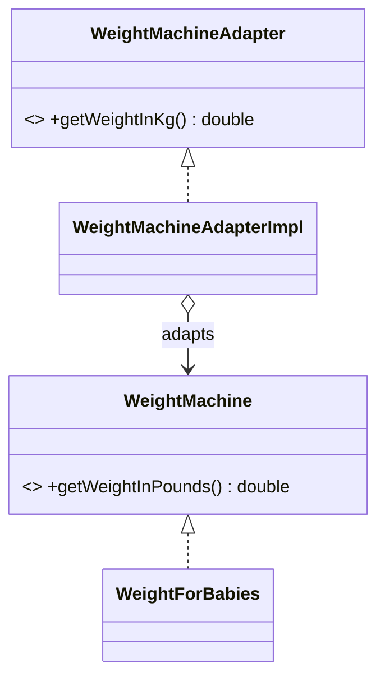

# Adapter

> Make an existing class fit the interface a client expects, without changing either.

## 1. Problem
A baby weighing machine reports pounds; the client wants kilograms. We cannot change the machine.

## 2. Class diagram


## 3. How it works
`WeightMachineAdapterImpl` wraps a `WeightMachine` and converts pounds to kg by multiplying by 0.45.

## 4. Design decisions
| Decision | Why |
|---|---|
| Composition (object adapter) | Works with any `WeightMachine`, not one subclass. |
| Separate target interface | The client is written against kilograms only. |

## 5. Trade-offs and alternatives rejected
- A class adapter (inheritance) would bind to one machine class.
- **When NOT to use it:** you own both sides; change the interface instead.

## 6. SOLID notes
**S** (conversion in one place), **O** (new machines need no new adapter), **D** (the adapter depends on an abstraction).

## 7. Known limitations
- The factor `0.45` is a rough approximation of 0.45359237.
- The output label says "kd" instead of "kg".

## 8. Interview follow-ups
- Two-way adapter?
- Adapting a third-party SDK so the domain never imports it?

## 9. Related topics
[Decorator](../decorator/README.md)

## Run it
```
mvn -q exec:java -Dexec.mainClass=patterns.adapter.EntryPoint
```
