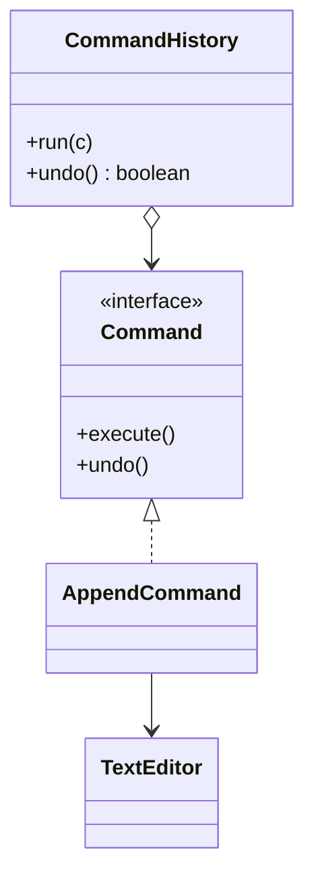

# Command

> Turn a request into an object so it can be queued, logged and undone.

## 1. Problem
A text editor needs undo. Calling `editor.append(...)` directly leaves nothing to reverse.

## 2. Class diagram


## 3. How it works
`CommandHistory.run()` executes a command and pushes it on a stack. `undo()` pops the most recent one and calls its `undo()`. `AppendCommand` remembers the editor length before it ran so it can truncate back.

## 4. Design decisions
| Decision | Why |
|---|---|
| Command stores what it needs to undo | The history stays generic and knows nothing about editors. |
| Stack for history | Undo order is always last-in, first-out. |

## 5. Trade-offs and alternatives rejected
- **Memento / snapshots**: store whole states; simple but memory-hungry.
- **Reverse operation computed on the fly**: works only when the operation is trivially invertible.

**When NOT to use it:** you never need undo, queuing or logging; a plain method call is clearer.

## 6. SOLID notes
**O** (new commands without touching the history), **S** (each command is one operation).

## 7. Known limitations
- No redo stack.
- Only append is implemented.
- Not thread-safe.

## 8. Interview follow-ups
- Add redo (second stack, cleared on a new command)?
- Macro commands (a composite of commands)?
- Persist the history for crash recovery?

## 9. Related topics
[Composite](../composite/README.md), [State](../state/README.md)

## Run it
```
mvn -q exec:java -Dexec.mainClass=patterns.command.EntryPoint
mvn -q test -Dtest='patterns/command/*'
```
