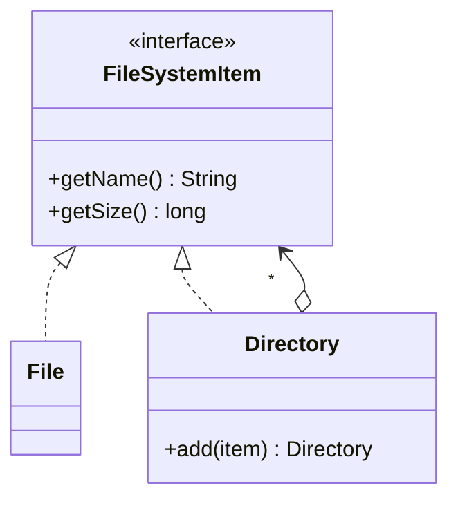

# Composite

> Treat single objects and groups of objects uniformly through a tree.

## 1. Problem
A file system has files and directories that contain both. Callers want one `getSize()` for any node.

## 2. Class diagram


## 3. How it works
`File.getSize()` returns its own size; `Directory.getSize()` sums its children's sizes, recursing through nested directories. The caller never checks which kind of node it holds.

## 4. Design decisions
| Decision | Why |
|---|---|
| Shared interface for leaf and composite | Uniform treatment is the whole point. |
| `add` only on `Directory` | A file can't hold children, so the compiler enforces it. |

## 5. Trade-offs and alternatives rejected
- **Separate code paths for files and folders**: `instanceof` checks everywhere.
- **Put `add` on the interface**: more uniform, but lets you call `add` on a file at runtime.

**When NOT to use it:** the hierarchy is flat or the part-whole relationship doesn't exist.

## 6. SOLID notes
**O** (new node types), **L** (every node is usable as a `FileSystemItem`).

## 7. Known limitations
- Size is recomputed on every call (no caching).
- No parent links, no cycle protection.
- Sizes could overflow only past `Long.MAX_VALUE`.

## 8. Interview follow-ups
- Cache sizes and invalidate on change?
- Prevent cycles?
- Add `find(name)` or `delete()`?

## 9. Related topics
[Decorator](../decorator/README.md), [Command](../command/README.md)

## Run it
```
mvn -q exec:java -Dexec.mainClass=patterns.composite.EntryPoint
mvn -q test -Dtest='patterns/composite/*'
```
