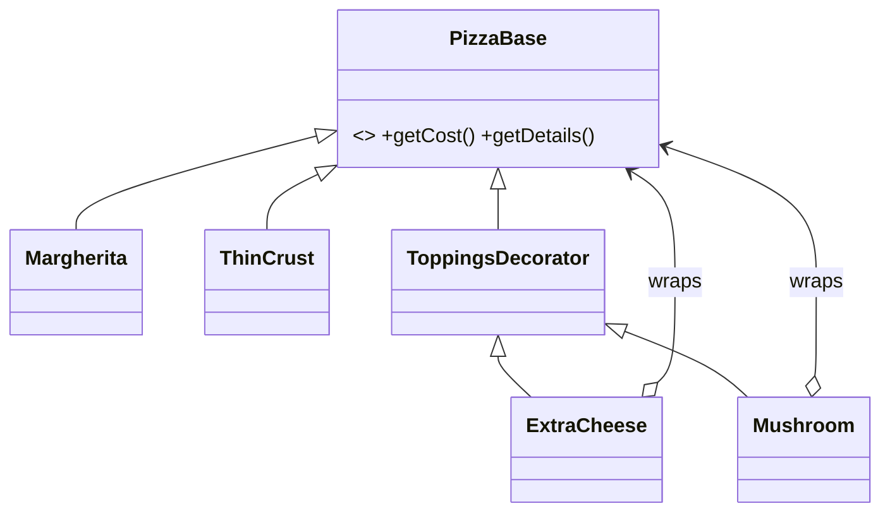

# Decorator

> Add behaviour to an object by wrapping it, instead of subclassing every combination.

## 1. Problem
A pizza has a base price and optional toppings. Subclassing `ThinCrustWithCheeseAndMushroom` for every combination does not scale.

## 2. Class diagram


## 3. How it works
`new Mushroom(new ExtraCheese(new ThinCrust()))` builds a chain. Each decorator calls the wrapped pizza and adds its own cost and description: 200 + 60 + 50 = 310.

## 4. Design decisions
| Decision | Why |
|---|---|
| Decorators extend the same abstract type as the thing they wrap | Callers cannot tell a plain pizza from a decorated one. |
| Cost and description are composed by delegation | No combinatorial subclasses. |

## 5. Trade-offs and alternatives rejected
- A list of `Topping` objects on a `Pizza` is simpler when toppings only add price and never change other behaviour.
- **When NOT to use it:** the extras are plain data, or decorators must be removed or inspected later (wrapping hides the inner objects).

## 6. SOLID notes
**O** (new topping without editing pizzas), **L** (a decorator is a `PizzaBase`).

## 7. Known limitations
- `ExtraCheese` and `Mushroom` each redeclare a `base` field instead of keeping it in `ToppingsDecorator`.
- Prices are hard-coded `int`s.

## 8. Interview follow-ups
- Move the shared `base` field into `ToppingsDecorator`?
- Double cheese (wrap twice)? It already works.
- Discounts or tax as decorators?

## 9. Related topics
[Strategy](../strategy/README.md), [Adapter](../adapter/README.md)

## Run it
```
mvn -q exec:java -Dexec.mainClass=patterns.decorator.EntryPoint
```
