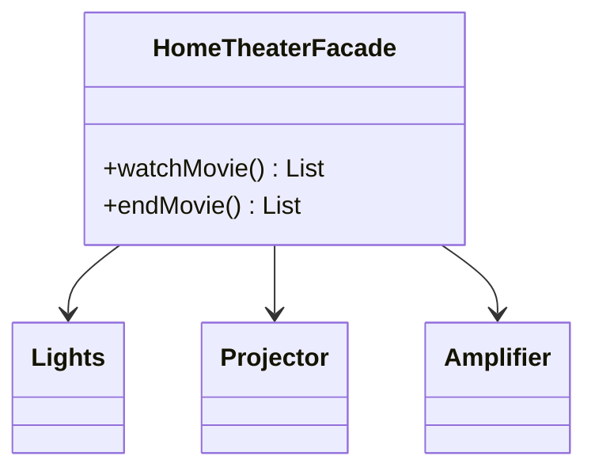

# Facade

> Offer one simple interface in front of a set of subsystem classes.

## 1. Problem
Starting a movie means dimming lights, starting the projector and setting volume, in the right order. Callers shouldn't repeat or get the order wrong.

## 2. Class diagram


## 3. How it works
`watchMovie()` drives the subsystems in order and returns the steps taken; `endMovie()` shuts them down in reverse. The subsystem classes are package-private, so clients can only reach them through the facade.

## 4. Design decisions
| Decision | Why |
|---|---|
| Subsystems package-private | The facade is the only public surface, which enforces the simplification. |
| Returns steps instead of printing | Makes the behaviour testable. |

## 5. Trade-offs and alternatives rejected
- **Expose the subsystems**: maximum flexibility, but every client repeats the choreography.
- **Mediator**: coordinates peers that talk to each other; a facade only simplifies a one-way view.

**When NOT to use it:** the subsystem is already simple, or the facade grows into a god class that knows everything.

## 6. SOLID notes
**S** is the risk: a facade that does too much. **D**: clients depend on one class instead of many.

## 7. Known limitations
- Fixed volume and steps; not configurable.
- Subsystem failures aren't handled mid-sequence.

## 8. Interview follow-ups
- Two facades for different audiences?
- Facade vs Adapter vs Mediator?
- Partial failure while starting up?

## 9. Related topics
[Adapter](../adapter/README.md), [Singleton](../singleton/README.md)

## Run it
```
mvn -q exec:java -Dexec.mainClass=patterns.facade.EntryPoint
mvn -q test -Dtest='patterns/facade/*'
```
