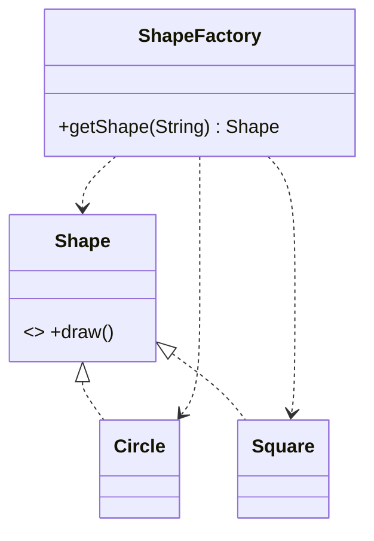

# Factory

> Centralise object creation so callers ask for a type by key and get the interface back.

## 1. Problem
Callers should draw shapes without knowing which concrete class implements them.

## 2. Class diagram


## 3. How it works
`ShapeFactory.getShape("circle")` returns a `Circle`; `"square"` returns a `Square`. The caller only holds a `Shape`.

## 4. Design decisions
| Decision | Why |
|---|---|
| Creation in one class | Adding a shape touches the factory, not every caller. |
| String key and a `switch` | Smallest thing that works for a teaching example. |

## 5. Trade-offs and alternatives rejected
- An enum key is safer than strings; a registry map allows registering shapes without editing the factory.
- **When NOT to use it:** there is one implementation, or construction is trivial.

## 6. SOLID notes
**D** (callers depend on `Shape`). The factory itself violates **O**: every new shape edits its `switch`.

## 7. Known limitations
- Unknown keys return `null` instead of failing fast.
- `Square.draw()` prints "Drawing rectangle".

## 8. Interview follow-ups
- Replace the `switch` with a registry?
- Throw instead of returning `null`?
- Factory Method vs Abstract Factory?

## 9. Related topics
[Abstract Factory](../abstractfactory/README.md), [Strategy](../strategy/README.md)

## Run it
```
mvn -q exec:java -Dexec.mainClass=patterns.factory.EntryPoint
```
