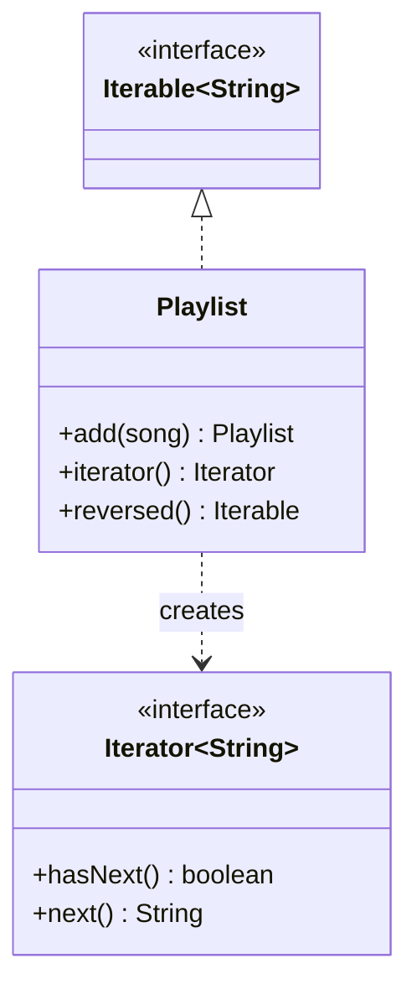

# Iterator

> Walk through a collection without exposing how it is stored.

## 1. Problem
`Playlist` stores songs in a list. Clients want to loop over them, forwards or backwards, without touching the list.

## 2. Class diagram


## 3. How it works
`Playlist implements Iterable<String>`, so it works in a for-each loop. Each call to `iterator()` returns a new independent cursor. `reversed()` returns another `Iterable` with a different traversal over the same data.

## 4. Design decisions
| Decision | Why |
|---|---|
| Cursor state lives in the iterator | Multiple traversals at once don't interfere. |
| `NoSuchElementException` past the end | Matches the `Iterator` contract. |

## 5. Trade-offs and alternatives rejected
- **Expose the list**: lets callers modify it and couples them to `List`.
- **Return a stream**: more powerful, a good choice in modern Java.

**When NOT to use it:** a plain `List` already serves, or you'd just wrap `ArrayList.iterator()`; write a custom iterator only for a custom structure or traversal order.

## 6. SOLID notes
**O** (new traversals without changing `Playlist`), **D** (clients depend on `Iterable`).

## 7. Known limitations
- `remove()` isn't supported.
- No fail-fast check for concurrent modification.

## 8. Interview follow-ups
- Make it fail-fast with a modification counter?
- Shuffle or filtered iterators?
- Iterator vs Stream?

## 9. Related topics
[Composite](../composite/README.md)

## Run it
```
mvn -q exec:java -Dexec.mainClass=patterns.iterator.EntryPoint
mvn -q test -Dtest='patterns/iterator/*'
```
