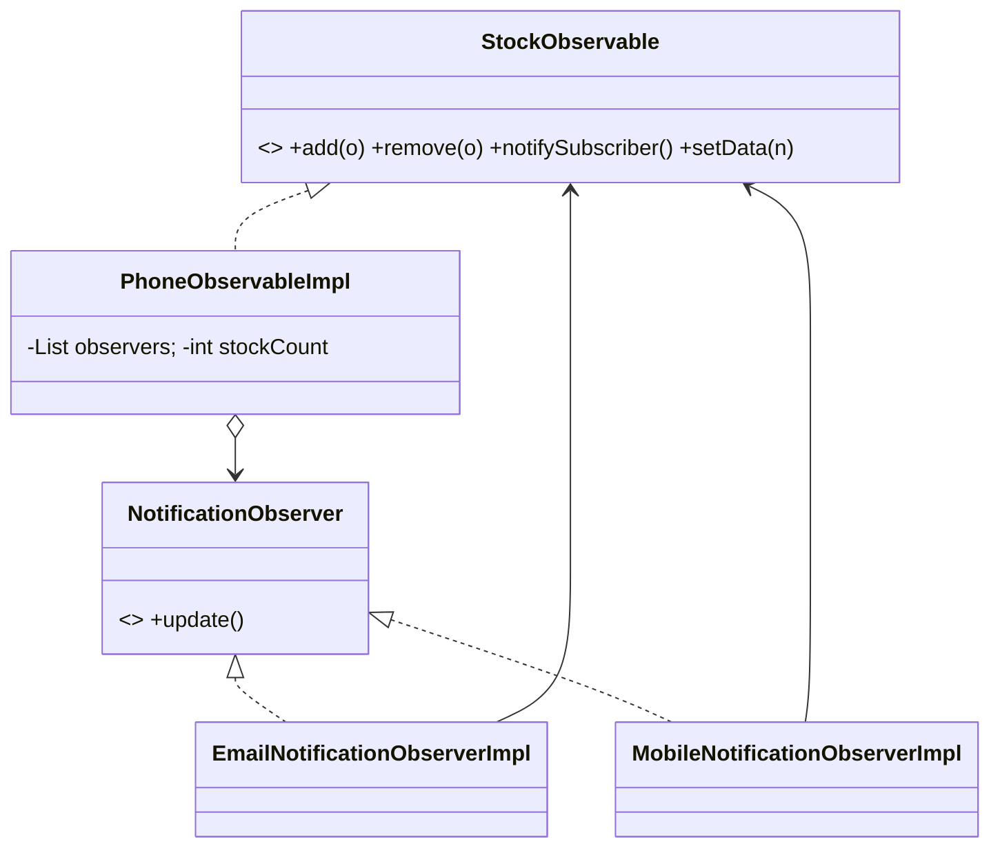

# Observer

> A subject keeps a list of subscribers and tells them when its state changes.

## 1. Problem
When a product is back in stock, every interested user must be notified (by email or SMS) without the stock object knowing how.

## 2. Class diagram


## 3. How it works
Observers register with `add`. `setData(n)` notifies every observer when the stock count is zero (the out-of-stock to in-stock transition), then adds `n` to the count.

## 4. Design decisions
| Decision | Why |
|---|---|
| Interfaces on both sides | Subject and observers are loosely coupled. |
| Notify only on the 0 to non-zero transition | Avoids spamming subscribers on every restock. |

## 5. Trade-offs and alternatives rejected
- A push model with no payload (`update()`) makes observers re-query the subject if they need data; passing the event is an alternative.
- **When NOT to use it:** a single, known listener, or when the order and timing of notifications must be strictly controlled.

## 6. SOLID notes
**O** (new notification channels without changing the subject), **D** (both sides depend on abstractions).

## 7. Known limitations
- `notifySubscriber()` runs *before* `stockCount` is updated, so an observer that reads the count during `update()` sees the old value.
- Observers are called synchronously and a failing one stops the rest.
- The list is not thread-safe.
- Observers keep a reference to the subject but do not use it yet.

## 8. Interview follow-ups
- Async notifications (executor) and failure isolation?
- Unsubscribe while iterating (copy-on-write list)?
- Pass the new value in `update(...)`?

## 9. Related topics
[Strategy](../strategy/README.md), [Logger](../../problems/logger/README.md)

## Run it
```
mvn -q exec:java -Dexec.mainClass=patterns.observer.EntryPoint
```
