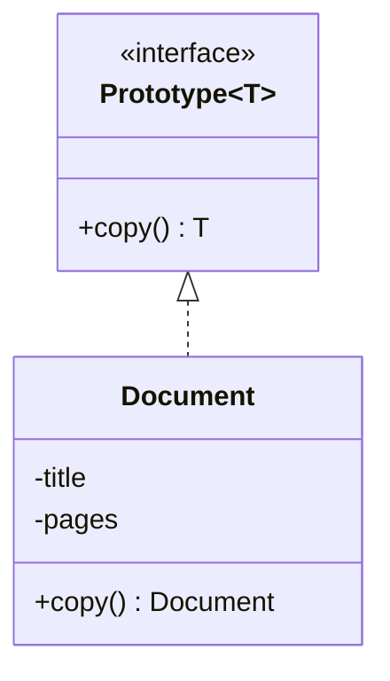

# Prototype

> Create new objects by copying an existing one instead of building from scratch.

## 1. Problem
Documents start from a template. Rebuilding each from zero is slow or needs knowledge the caller shouldn't have; copying must not leave two documents sharing state.

## 2. Class diagram


## 3. How it works
`Document.copy()` builds a new `Document` with the same title and a new `ArrayList` of the same pages, so editing the copy never touches the original.

## 4. Design decisions
| Decision | Why |
|---|---|
| Own `copy()` instead of `Cloneable` | `Object.clone()` is shallow, unchecked and widely considered broken. |
| Copy the mutable list | Sharing it would let a change in one document leak into the other. |

## 5. Trade-offs and alternatives rejected
- **Copy constructor**: same effect, less ceremony, but not polymorphic through an interface.
- **Serialization round trip**: deep but slow and fragile.
- **Builder**: better when you configure a new object rather than clone a configured one.

**When NOT to use it:** objects are cheap to build, or immutable (then sharing is fine and copying is wasted work).

## 6. SOLID notes
**O** (callers copy through the interface and never name the concrete class), **L** (copies are substitutable).

## 7. Known limitations
- `copy()` is hand-written, so adding a field means remembering to copy it.
- Page strings are immutable, which is why a shallow list copy is deep enough here.

## 8. Interview follow-ups
- Deep vs shallow copy of nested mutable objects?
- A prototype registry (name to prototype)?
- Why not `clone()`?

## 9. Related topics
[Builder](../builder/README.md), [Factory](../factory/README.md)

## Run it
```
mvn -q exec:java -Dexec.mainClass=patterns.prototype.EntryPoint
mvn -q test -Dtest='patterns/prototype/*'
```
