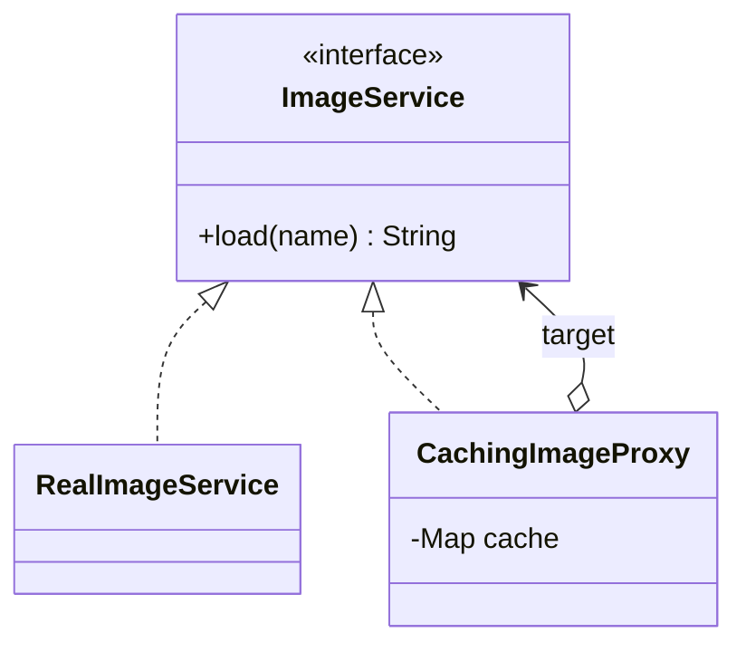

# Proxy

> Stand in for another object behind the same interface to control access to it.

## 1. Problem
Loading an image is slow; the same image is requested repeatedly. Callers shouldn't need to know a cache exists.

## 2. Class diagram


## 3. How it works
`CachingImageProxy` implements `ImageService`. On `load(name)` it returns the cached value, or asks the real service once and stores the result.

## 4. Design decisions
| Decision | Why |
|---|---|
| Same interface as the target | Callers can be given either without changing code. |
| Proxy takes the target as `ImageService` | Proxies can be stacked (logging over caching over real). |

## 5. Trade-offs and alternatives rejected
- **Decorator** has the same shape but adds behaviour; a proxy *controls access* (cache, lazy load, permissions, remote call).
- **Cache inside the real service**: simpler but mixes two responsibilities.

**When NOT to use it:** you can change the real class directly and there's no access concern to separate.

## 6. SOLID notes
**S** (caching is separate from loading), **O** (add proxies without editing the real service), **L**.

## 7. Known limitations
- Unbounded cache with no eviction or expiry.
- Not thread-safe (`HashMap`).

## 8. Interview follow-ups
- Add LRU eviction or TTL?
- Virtual proxy (lazy load) and protection proxy (permissions)?
- Dynamic proxies via `java.lang.reflect.Proxy`?

## 9. Related topics
[Decorator](../decorator/README.md), [Adapter](../adapter/README.md)

## Run it
```
mvn -q exec:java -Dexec.mainClass=patterns.proxy.EntryPoint
mvn -q test -Dtest='patterns/proxy/*'
```
