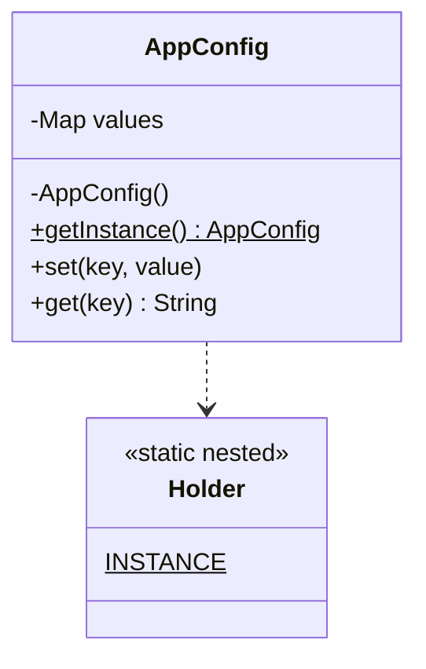

# Singleton

> Guarantee exactly one instance and give everyone a global access point to it.

## 1. Problem
Application configuration must be shared by every component; two copies would drift apart.

## 2. Class diagram


## 3. How it works
`getInstance()` returns `Holder.INSTANCE`. The JVM initialises the nested `Holder` class once, the first time it is touched, so creation is lazy and thread-safe without any `synchronized`.

## 4. Design decisions
| Decision | Why |
|---|---|
| Initialization-on-demand holder | Lazy and thread-safe with no locking cost on the hot path. |
| Private constructor, `final` class | Nothing can create or subclass a second instance. |
| `ConcurrentHashMap` inside | The instance is shared across threads, so its state must be thread-safe too. |

## 5. Trade-offs and alternatives rejected
- **Eager static field**: simplest and thread-safe, but initialises even if never used.
- **Double-checked locking**: needs `volatile`, easy to get wrong.
- **Enum singleton**: also safe against reflection and serialization attacks; can't extend a class.

**When NOT to use it:** you only need one instance *by convention*. Prefer passing a single object in through constructors (dependency injection). A global makes tests share state and hides dependencies.

## 6. SOLID notes
**S** is stretched (the class manages its own lifecycle). **D** is violated for callers that reach for `getInstance()` instead of receiving the dependency.

## 7. Known limitations
- State persists for the whole JVM, so tests that write to it can affect each other.
- Reflection can still call the private constructor.

## 8. Interview follow-ups
- Why is double-checked locking broken without `volatile`?
- How do you test code that uses a singleton?
- Singleton per classloader vs per JVM?

## 9. Related topics
[Factory](../factory/README.md), [Facade](../facade/README.md)

## Run it
```
mvn -q exec:java -Dexec.mainClass=patterns.singleton.EntryPoint
mvn -q test -Dtest='patterns/singleton/*'
```
