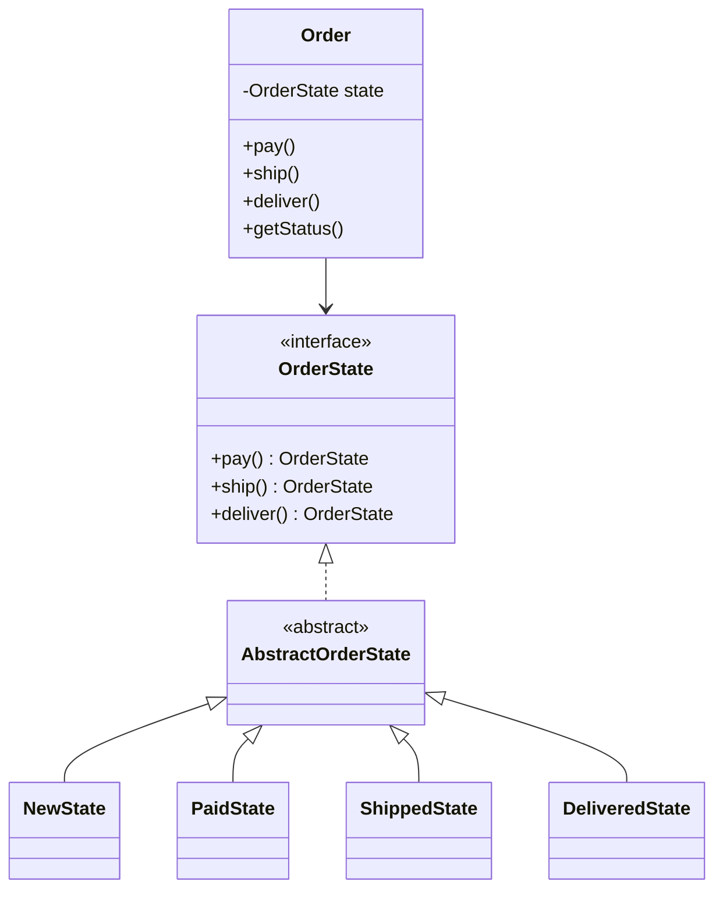

# State

> Let an object change its behaviour when its internal state changes, by delegating to a state object.

## 1. Problem
An order moves NEW, PAID, SHIPPED, DELIVERED. Each action is only valid in some states; `if (status == ...)` checks spread across the code.

## 2. Class diagram


## 3. How it works
`Order` delegates each action to its current state and stores the state it returns. `AbstractOrderState` throws `IllegalStateException` for every action by default; each concrete state overrides only the one transition it allows. A failed transition throws before `Order` reassigns, so the state is unchanged.

## 4. Design decisions
| Decision | Why |
|---|---|
| States return the next state | Transition logic lives in the states, not in `Order`. |
| Throwing defaults in a base class | Illegal transitions are the default, so a new state is safe until you opt actions in. |

## 5. Trade-offs and alternatives rejected
- **Enum with a switch**: fine for a small, fixed machine.
- **Transition table (Map)**: data-driven and easy to visualise, loses per-state behaviour.

**When NOT to use it:** there are two or three states with little behaviour; an enum and a switch is shorter.

## 6. SOLID notes
**O** (new state is a new class), **S** (one class per state). **L** holds because every state honours the interface.

## 7. Known limitations
- States are not shared singletons, so a new object is created per transition.
- No cancel or refund transitions.

## 8. Interview follow-ups
- Add CANCELLED (allowed from NEW and PAID only)?
- Notify listeners on transitions (combine with Observer)?
- State vs Strategy?

## 9. Related topics
[Strategy](../strategy/README.md), [Observer](../observer/README.md)

## Run it
```
mvn -q exec:java -Dexec.mainClass=patterns.state.EntryPoint
mvn -q test -Dtest='patterns/state/*'
```
