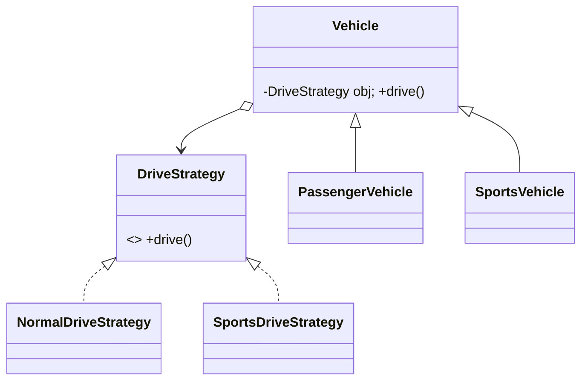

# Strategy

> Pull a varying behaviour out into an interface so it can be chosen per object and swapped without subclass explosions.

## 1. Problem
Vehicles drive differently (normal, sports). Putting that in `Vehicle` subclasses duplicates code as variants combine; the behaviour should be a plugin.

## 2. Class diagram


## 3. How it works
`Vehicle.drive()` delegates to its `DriveStrategy`. `PassengerVehicle` and `SportsVehicle` only choose which strategy to pass to `super(...)`.

## 4. Design decisions
| Decision | Why |
|---|---|
| Strategy injected through the constructor | The vehicle never names a concrete strategy. |
| Subclasses only select a strategy | Keeps vehicle types readable; the behaviour lives elsewhere. |

## 5. Trade-offs and alternatives rejected
- A subclass override per behaviour is fine until behaviours combine across several axes.
- With Java lambdas, a one-method strategy can be a `Runnable` or lambda instead of a class.
- **When NOT to use it:** only one behaviour exists, or it never changes. An `if` is clearer.

## 6. SOLID notes
**O** (new strategy, no edits to `Vehicle`), **D** (depends on the interface), **S** (each strategy has one job).

## 7. Known limitations
- The strategy is fixed at construction; there is no setter to change it at runtime.
- The `Vehicle` subclass constructors are package-private.

## 8. Interview follow-ups
- Change strategy at runtime (add a setter)?
- Pick a strategy from config (combine with [Factory](../factory/README.md))?
- Strategies with state or parameters?

## 9. Related topics
[Factory](../factory/README.md), [Decorator](../decorator/README.md)

## Run it
```
mvn -q exec:java -Dexec.mainClass=patterns.strategy.EntryPoint
```
