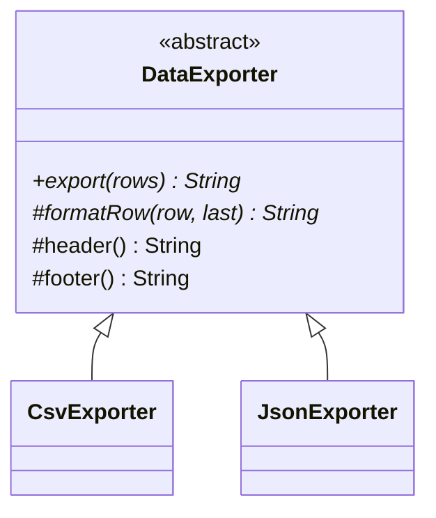

# Template Method

> Fix the skeleton of an algorithm in a base class and let subclasses fill in the steps.

## 1. Problem
Exporting rows to CSV and JSON follows the same sequence (header, each row, footer) with different formatting.

## 2. Class diagram


## 3. How it works
`export()` is `final`: it writes the header, calls `formatRow` for each row and appends the footer. `formatRow` is abstract; `header` and `footer` are hooks that default to empty.

## 4. Design decisions
| Decision | Why |
|---|---|
| `final` template method | Subclasses can't reorder or skip steps. |
| Hooks with empty defaults | Subclasses override only what they need. |

## 5. Trade-offs and alternatives rejected
- **Strategy**: compose a formatter object instead of inheriting; more flexible, more wiring.
- **Plain functions/lambdas**: enough when there is a single varying step.

**When NOT to use it:** the variation changes at runtime or needs several independent axes; inheritance fixes the choice at compile time (use [Strategy](../strategy/README.md)).

## 6. SOLID notes
**O** (new formats are new subclasses). Beware **L**: subclasses must honour the skeleton's assumptions.

## 7. Known limitations
- The `last` flag leaks a JSON concern (commas) into the base signature.
- No escaping of quotes in JSON values.

## 8. Interview follow-ups
- Template Method vs Strategy?
- Why the hollywood principle ("don't call us, we'll call you")?
- Streaming very large exports?

## 9. Related topics
[Strategy](../strategy/README.md), [Factory](../factory/README.md)

## Run it
```
mvn -q exec:java -Dexec.mainClass=patterns.templatemethod.EntryPoint
mvn -q test -Dtest='patterns/templatemethod/*'
```
