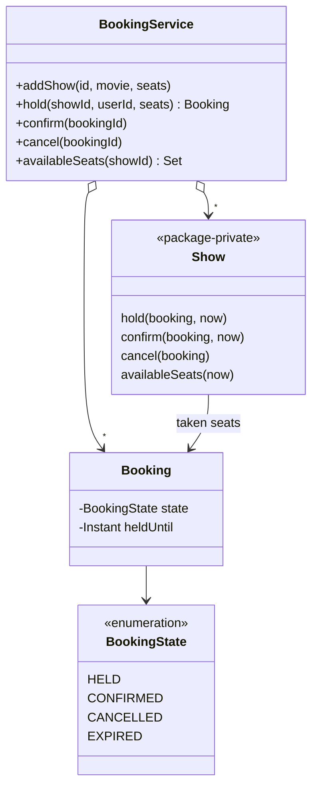

# BookMyShow (Ticket Booking)

> Reserve seats for a show so that no seat is ever sold twice, even under heavy concurrent demand.

## 1. Problem
- A show has a set of seats. Users pick one or more seats.
- Booking is two steps: **hold** the seats for a limited time (while the user pays), then **confirm**.
- A hold that is not confirmed in time expires and the seats are released.
- A booking is all-or-nothing: if any requested seat is taken, none is held.
- A seat can never belong to two bookings, however many users compete.
- Out of scope: pricing, payment, theatres and screens, search, seat categories.

## 2. Class diagram


## 3. How it works
`BookingService.hold` creates a `Booking` with a deadline and passes it to the `Show`. The show, under its own lock, first sweeps expired holds, then checks that **every** requested seat is free, and only then claims them all. `confirm` moves a held booking to `CONFIRMED` (expired ones are refused); `cancel` frees the seats of a held or confirmed booking.

Expiry is **lazy**: nothing runs in the background. A stale hold is released the next time someone touches that show.

## 4. Design decisions
| Decision | Why |
|---|---|
| Lock per `Show` | Bookings for different shows never wait on each other, and within a show check-and-claim is atomic. |
| All-or-nothing hold | A user never ends up with half of the seats they wanted. |
| Hold then confirm | Matches real payment flow and stops people hoarding seats. |
| Lazy expiry | No scheduler thread to manage; correctness comes from checking the clock under the lock. |
| Injected `Clock` | Tests move time instead of sleeping. |
| `seat -> booking` map | One lookup tells whether a seat is free and who owns it. |

## 5. Trade-offs and alternatives rejected
- **Optimistic concurrency** (a version number or compare-and-set per seat) scales better across many servers; for one JVM a lock is simpler.
- **A background reaper thread** frees seats on time even when nobody is looking, but adds lifecycle and shutdown concerns.
- **Per-seat locks** reduce contention but need ordered locking to avoid deadlocks on multi-seat bookings.
- **When NOT to use this design:** across several servers, the lock has to live in the database (a unique constraint or `SELECT ... FOR UPDATE`).

## 6. SOLID notes
**S** (service orchestration vs seat bookkeeping), **O** (pricing or seat categories can be added without touching the hold logic). The `Show` internals are package-private.

## 7. Known limitations
- Single process; state is in memory.
- Expired holds are only noticed when the show is next accessed.
- A booking's state is changed under its show's lock, but `getState()` can be read without it.
- No payment or user validation.

## 8. Interview follow-ups
- Multiple servers? Move the claim into the database with a unique constraint on `(show, seat)` or a row lock, and run a reaper job.
- A rush for popular shows? A waiting room or queue in front of the hold step.
- Seat categories and pricing? A `PricingStrategy`, like the [parking lot](../parkinglot/README.md).
- Show the seat map? Return statuses, not just free seats.
- Release holds on time? Use a `DelayQueue` or scheduled executor.

## 9. Related topics
[Concurrency notes](../../../../../docs/concurrency.md), [Parking lot](../parkinglot/README.md), [State](../../patterns/state/README.md)

## Run it
```
mvn -q exec:java -Dexec.mainClass=problems.bookmyshow.EntryPoint
mvn -q test -Dtest=BookingServiceTest
```
