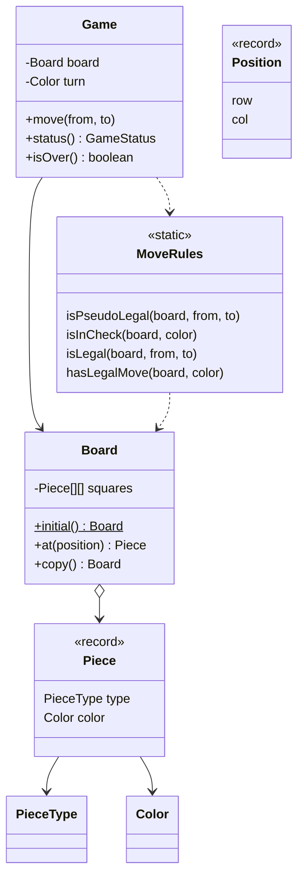

# Chess

> A two-player game engine that enforces how pieces move, whose turn it is, and detects check, checkmate and stalemate.

## 1. Problem
- An 8x8 board with the standard starting position; White moves first.
- Each piece type moves by its own rules; sliding pieces cannot jump; pieces cannot capture their own side.
- A move that leaves your own king in check is illegal.
- Pawns move forward, capture diagonally and may advance two squares from their start rank. A pawn reaching the last rank becomes a queen.
- The game reports check, **checkmate** (in check with no legal move) and **stalemate** (not in check with no legal move).
- Out of scope: castling, en passant, choosing a promotion piece, draw by repetition or the fifty-move rule, clocks, a UI.

## 2. Class diagram


## 3. How it works
`Game.move` checks that a piece exists and belongs to the side to move, then asks `MoveRules.isLegal`. That has two layers:

1. **Pseudo-legal**: does the move follow the piece's movement rules (with path-clear checks for sliders, and the special pawn rules), ignoring check?
2. **King safety**: copy the board, play the move on the copy, and reject it if the mover's king is attacked.

`status()` combines `isInCheck` with `hasLegalMove`: no legal move means checkmate when in check, stalemate when not.

"Is the king attacked?" reuses the pseudo-legal check: a king is attacked if any enemy piece could legally *capture* on its square. This also gets pawns right: a pawn's forward move needs an empty target, so it never attacks straight ahead.

## 4. Design decisions
| Decision | Why |
|---|---|
| `Piece` and `Position` are records | They are immutable values, so boards can be copied by copying the array. |
| All rules in a stateless `MoveRules` | The rules can be read and tested without a game, and `Game` stays small. |
| Simulate on a copy to test king safety | One rule covers pins, moving into check and answering a check. |
| `switch` over `PieceType` in the rules | Compact and exhaustive; the compiler flags a new piece type. |
| `Game(Board, Color)` constructor | Lets tests set up exact positions (stalemate, promotion, pins). |

## 5. Trade-offs and alternatives rejected
- **A class per piece** (`Rook extends Piece` with its own `canMove`) is the textbook answer and reads well, but spreads the rules across seven files. A switch is easier to scan at this size; use polymorphism if pieces gain more behaviour (move generation, evaluation).
- **Brute-force `hasLegalMove`** tries all 64 targets for each piece (about 4000 checks). Fine for a rules engine; a search engine would generate moves per piece instead.
- **Copying the board** to test a move is simple and safe; make/unmake on one board is faster but easier to get wrong.
- **When NOT to use this design:** for an AI that searches millions of positions, use bitboards and incremental move generation.

## 6. SOLID notes
**S** (state in `Game`, rules in `MoveRules`, data in `Board`), **O** (adding a piece type means a new enum value and one `case`). The switch means open/closed is bent, in exchange for clarity.

## 7. Known limitations
- No castling, en passant or under-promotion (always a queen).
- No draw rules other than stalemate: insufficient material, repetition and the fifty-move rule are not detected.
- Moves are `from, to` squares only; there is no algebraic notation parser (`Nf3`).
- `Game` does not copy the `Board` it is given, so a caller who keeps a reference can change the game.
- No move history.

## 8. Interview follow-ups
- Add castling? It needs per-piece "has moved" state and a check that the king does not pass through an attacked square.
- En passant? Remember the previous move (or the pawn that just advanced two).
- Undo or move list? Keep a stack of moves, as in the [Command pattern](../../patterns/command/README.md).
- A computer opponent? Generate legal moves and search with minimax and alpha-beta pruning.
- Per-piece classes instead of a switch? Show how `Piece` could hold a `MovementStrategy`.

## 9. Related topics
[Tic-Tac-Toe](../tictactoe/README.md), [Strategy](../../patterns/strategy/README.md), [Command](../../patterns/command/README.md)

## Run it
```
mvn -q exec:java -Dexec.mainClass=problems.chess.EntryPoint
mvn -q test -Dtest=GameTest
```
