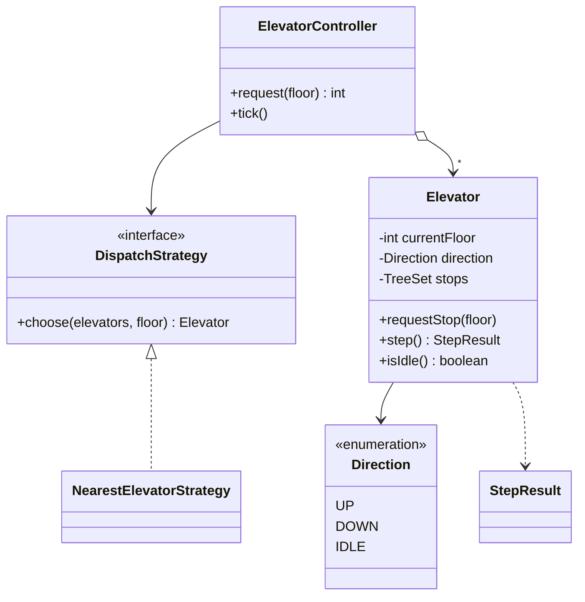

# Elevator System

> Cars that serve floor requests in an efficient sweep order, and a controller that picks which car to send.

## 1. Problem
- A building has floors `0..top` and one or more elevator cars.
- Passengers request a floor; a car must eventually stop there.
- A car should not zig-zag: serve requests along its current direction, then reverse.
- With several cars, send the most suitable one.
- Out of scope: door timing, weight limits, separate up/down hall buttons, emergency modes.

## 2. Class diagram


## 3. How it works
Each car keeps its pending stops in a sorted set. On every `step()` it moves one floor. If it's heading up and a stop exists above it, it keeps going up; same for down. Only when nothing is left ahead does it turn towards the nearer remaining stop (or go idle). This is the **LOOK** algorithm: a disk-scheduling idea applied to elevators. `step()` reports the new floor, direction and whether the doors opened.

`ElevatorController.request(floor)` asks the `DispatchStrategy` for a car and gives it the stop. The nearest-car strategy compares distances (lowest id on ties).

## 4. Design decisions
| Decision | Why |
|---|---|
| Discrete `step()` instead of threads and timers | The simulation is deterministic and testable; a real driver just calls `tick()` on a clock. |
| `TreeSet` of stops | Sorted order and `higher()`/`lower()` make LOOK a few lines; duplicates vanish. |
| Dispatch as a Strategy | Nearest, least-loaded or zoned dispatch are interchangeable. |
| `StepResult` record | Callers (and tests) see what happened without reading internal state. |

## 5. Trade-offs and alternatives rejected
- **FCFS** (serve in arrival order) is simple but wastes trips.
- **SCAN** always travels to the end of the building before reversing; LOOK stops at the last request.
- **Nearest-car** ignores direction: a car going the other way may be chosen. A cost function that counts direction, load and queued stops is better.
- **When NOT to use this design:** for a real system with real-time hardware, make state transitions explicit (door open, moving, stopped) with a [State machine](../../patterns/state/README.md).

## 6. SOLID notes
**S** (one car's scheduling, separate from fleet choice), **O/D** (new dispatch policies without touching `Elevator`).

## 7. Known limitations
- A request is just a floor; there is no distinction between a hall call (up or down) and a destination button, so a car may carry someone the wrong way.
- Dispatch uses current floor only, not queued stops or direction.
- No capacity or door states.
- Not thread-safe.

## 8. Interview follow-ups
- Up/down hall buttons? Store `(floor, direction)` requests and only pick them up when the car is heading that way.
- Better dispatch? Estimate arrival time per car, including its existing stops.
- Door and movement states? Model `MOVING`, `DOORS_OPEN`, `IDLE` with State.
- Concurrent requests from many floors? The controller needs a lock, or a request queue consumed by the tick loop.

## 9. Related topics
[State](../../patterns/state/README.md), [Strategy](../../patterns/strategy/README.md), [Command](../../patterns/command/README.md) for queued requests

## Run it
```
mvn -q exec:java -Dexec.mainClass=problems.elevator.EntryPoint
mvn -q test -Dtest=ElevatorTest
```
