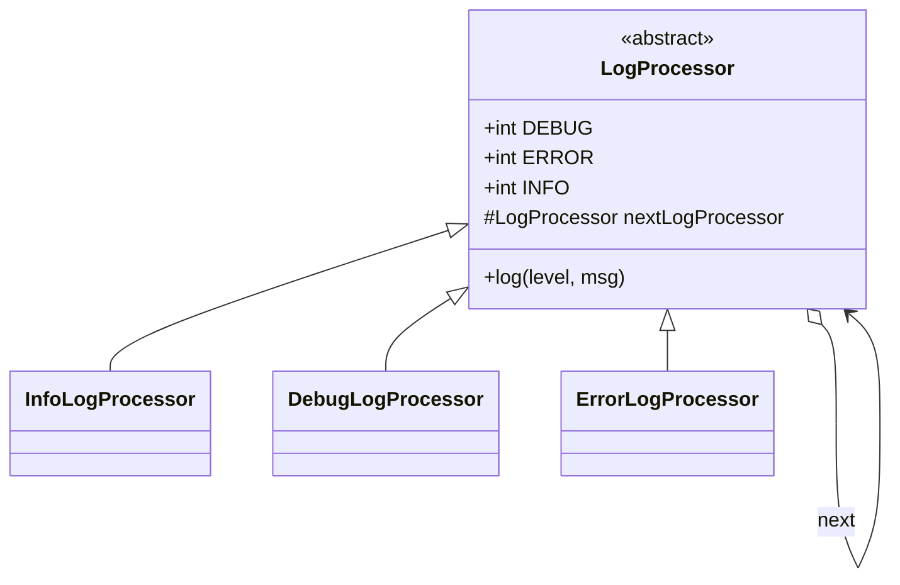

# Logger (Chain of Responsibility)

> A log message travels along a chain of handlers until the one that owns its level prints it.

## 1. Problem
- Support the levels `DEBUG`, `ERROR` and `INFO`, each printed with its own prefix.
- Adding a level or changing the order must not touch existing handlers.
- Out of scope: output destinations (file, network), formatting, async logging.

## 2. Class diagram


## 3. How it works
`EntryPoint` builds `Info -> Debug -> Error`. Each handler checks `logLevel`; on a
match it prints `LEVEL: msg`, otherwise it calls `super.log(...)`, which forwards to
the next handler. The last handler has `null` as its next, so an unknown level is dropped.

## 4. Design decisions
| Decision | Why |
|---|---|
| Handlers hold a reference to the next one | The sender only knows the head of the chain. |
| One class per level | Adding a level is a new class plus one line of wiring. |
| Base class does the forwarding | Subclasses only write the "is this mine?" check. |

## 5. Trade-offs and alternatives rejected
- A `Map<Level, Handler>` or `switch` is simpler and O(1) when exactly one handler runs per message. The chain pays off when several handlers may act on one message (for example, an error goes to both console and file) or when order matters.
- **When NOT to use it:** if every message has exactly one fixed destination and you never reorder handlers.

## 6. SOLID notes
- **O**: new handlers need no changes to existing ones.
- **S**: each handler handles one level.
- Weak spot: the level constants live on the abstract base class, so adding a level edits `LogProcessor`.

## 7. Known limitations
- Levels are mutable `public static int` fields, not an enum.
- Handler constructors are package-private, so a chain can only be built inside this package.
- A handler stops the chain on a match, so a message cannot reach two destinations.
- Output goes straight to `System.out`.

## 8. Interview follow-ups
- **Level thresholds** (log everything at or above WARN)? Compare with `>=` and keep forwarding.
- **Multiple appenders** (console + file)? Handle the message, then always call `super.log`.
- **Thread safety?** Handlers are stateless, so the chain is safe; the appender needs a lock or a queue.
- **Runtime reconfiguration?** Make `nextLogProcessor` swappable and guard it.

## 9. Related topics
- [Strategy](../../patterns/strategy/README.md) for choosing an output format
- [Observer](../../patterns/observer/README.md) for fan-out to several sinks

## Run it
```
mvn -q exec:java -Dexec.mainClass=problems.logger.EntryPoint
mvn -q test -Dtest=LogProcessorTest
```
