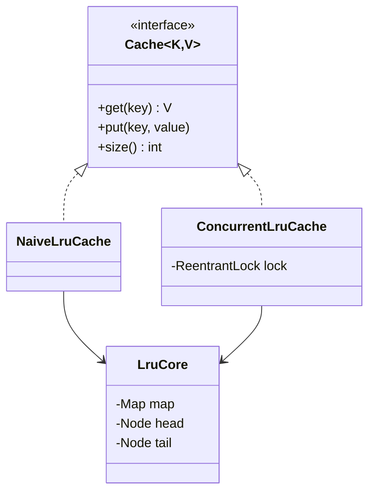

# LRU Cache

> A fixed-size cache that evicts the least recently used entry, with O(1) `get` and `put`, in an unsafe and a thread-safe version.

## 1. Problem
- `get(key)` returns the value or `null`; `put(key, value)` inserts or updates.
- When the cache is full, adding a new key evicts the least recently used one.
- Both operations are O(1). A `get` counts as a use.
- Must be safe to share between threads (the `Concurrent` version).
- Out of scope: TTL expiry, loading on miss, statistics.

## 2. Class diagram


## 3. How it works
`LruCore` keeps a `HashMap` from key to node and a doubly linked list ordered by recency (most recent next to the head, eldest next to the tail). A hit unlinks the node and moves it to the front; an insert into a full cache unlinks the node before the tail and removes its key from the map. Sentinel head and tail nodes remove all null checks.

`NaiveLruCache` exposes the core directly. `ConcurrentLruCache` wraps every call in one `ReentrantLock`.

## 4. Design decisions
| Decision | Why |
|---|---|
| Hand-written map + linked list | It is the classic interview answer and shows why both structures are needed. |
| One core, two wrappers | The logic exists once; the only difference between the versions is locking. |
| One exclusive lock | `get` reorders the list, so a read/write lock would not allow concurrent readers. |
| Sentinel nodes | No special cases at either end of the list. |

## 5. Trade-offs and alternatives rejected
- **`LinkedHashMap(accessOrder=true)` + `removeEldestEntry`** is a three-line LRU. In production, use it; hand-rolling is for interviews. It has the same thread-safety problem.
- **`Collections.synchronizedMap`** makes each call atomic but is just as coarse as one lock.
- **Striped/segmented locking** scales better but each segment then has its own LRU order, so eviction is only approximately global (this is what Caffeine-style caches do).
- **When NOT to use it:** if reads dominate and exact LRU order is not required, a concurrent cache with approximate eviction scales far better.

## 6. SOLID notes
**S** (ordering logic separate from locking), **O** (a new synchronisation strategy is a new wrapper), **D** (callers depend on `Cache`).

## 7. Known limitations
- One lock serialises all operations.
- No null keys or values are distinguished: a stored `null` value looks like a miss.
- The race test is timing-dependent, so it is skipped (not failed) when the race doesn't show up.

## 8. Interview follow-ups
- Make it faster under contention? Lock striping, or buffer the recency updates and apply them in batches.
- Add TTL? Store an expiry per node and check it on `get`.
- LFU instead of LRU? Frequency buckets, each a linked list.
- Why a doubly linked list, not a singly linked one? Unlinking a node in O(1) needs its predecessor.

## 9. Related topics
[Concurrency notes](../../../../../docs/concurrency.md), [Rate limiter](../ratelimiter/README.md)

## Run it
```
mvn -q exec:java -Dexec.mainClass=problems.lrucache.EntryPoint
mvn -q test -Dtest=LruCacheTest
```
