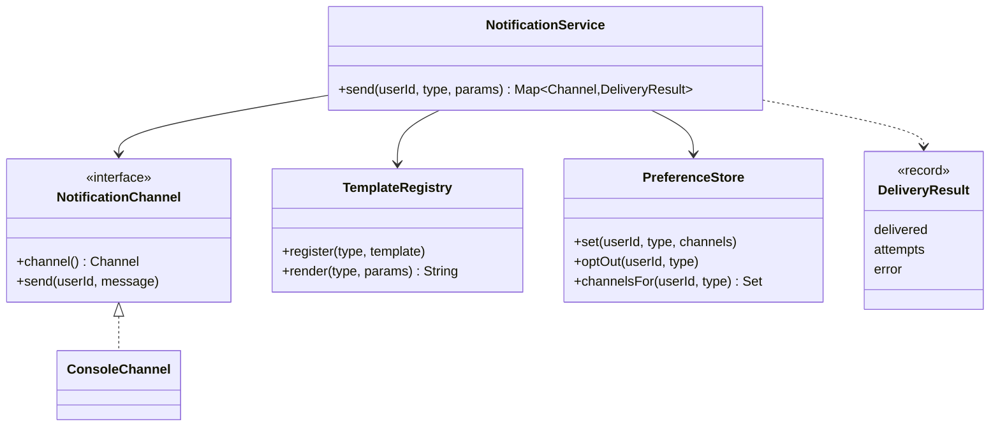

# Notification Service

> Send a message to a user over email, SMS and push, honouring their preferences and surviving flaky providers.

## 1. Problem
- Notifications have a **type** (such as `ORDER_SHIPPED`) with a message template, for example `Hi {name}, order {id} has shipped.`
- Each user chooses which channels they want per type; with no preference every channel is used, and users can opt out entirely.
- A channel can fail; delivery is retried a limited number of times.
- One failing channel must not stop delivery on the others, and the caller learns what happened per channel.
- Out of scope: real providers, asynchronous queues, scheduling, localisation, deduplication.

## 2. Class diagram


## 3. How it works
`send` renders the template first, so a bad type or a missing parameter fails **before anything is sent**. It then asks the `PreferenceStore` which channels the user wants for this type, and for each one that has a registered sender it tries up to `maxAttempts` times, catching `DeliveryException`. The result is a map of channel to `DeliveryResult` (delivered or not, attempts used, last error). Channels the user opted out of do not appear.

## 4. Design decisions
| Decision | Why |
|---|---|
| `NotificationChannel` interface ([Strategy](../../patterns/strategy/README.md)) | A new channel is a new class; the service never changes. |
| Render once, deliver many | Every channel sends the same text, and errors surface early. |
| Retries per channel | A flaky SMS gateway doesn't repeat a successful email. |
| Failures are data (`DeliveryResult`), not exceptions | The caller can see a partial success and decide what to do. |
| Opt-in default is "all channels" | A new user receives notifications until they choose otherwise. |
| Missing template parameter is an error | Prevents sending "Hi null". |

## 5. Trade-offs and alternatives rejected
- **Synchronous sending** is simplest and gives immediate results, but slow providers block the caller. Production systems enqueue the message and send from workers.
- **Immediate retries** hammer a struggling provider; real systems back off exponentially and may use a dead-letter queue.
- **Per-channel templates** (short for SMS, rich HTML for email) are common; here one text is shared to keep the example small.
- **When NOT to use this design:** high volume. Use a queue, batching and idempotency keys (to avoid duplicate sends on retry).

## 6. SOLID notes
**O** (new channels, no service edits), **D** (the service depends on the channel interface, not providers), **S** (rendering, preferences and delivery are separate classes).

## 7. Known limitations
- Synchronous and single-threaded; retries happen immediately with no delay.
- Only `DeliveryException` is retried; other runtime exceptions from a channel propagate.
- `PreferenceStore` and `TemplateRegistry` are not thread-safe.
- One template per type; no localisation.
- A real provider call that times out may have delivered, so retrying can send twice without an idempotency key.

## 8. Interview follow-ups
- Make it asynchronous? Put messages on a queue per channel and have worker pools consume them.
- Back-off and give-up? Exponential delay with jitter, then a dead-letter queue.
- Avoid sending duplicates? Idempotency key per (user, type, event).
- Rate limit per user? Plug in the [rate limiter](../ratelimiter/README.md).
- Priorities (OTP vs marketing)? Separate queues, or a priority queue.
- Add observers (metrics, audit)? Publish an event per attempt ([Observer](../../patterns/observer/README.md)).

## 9. Related topics
[Strategy](../../patterns/strategy/README.md), [Observer](../../patterns/observer/README.md), [Rate limiter](../ratelimiter/README.md)

## Run it
```
mvn -q exec:java -Dexec.mainClass=problems.notificationservice.EntryPoint
mvn -q test -Dtest=NotificationServiceTest
```
