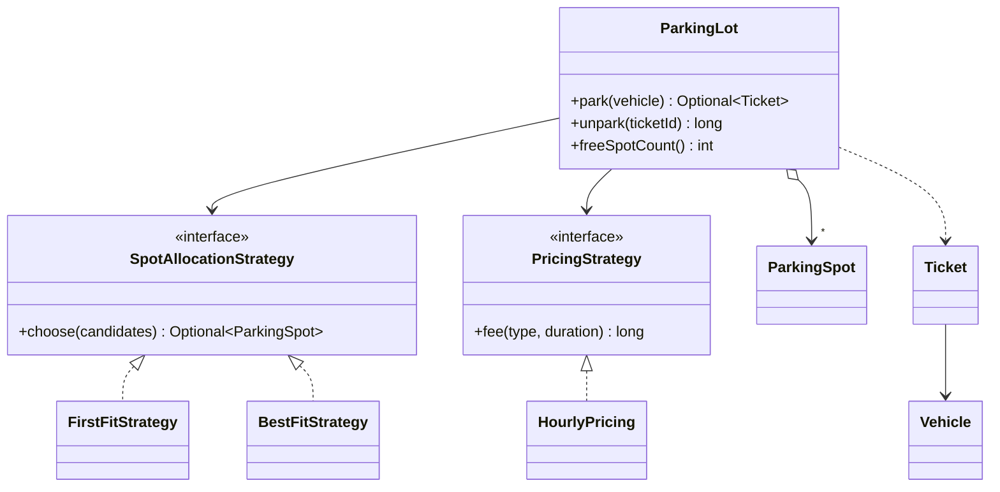

# Parking Lot

> Park and release vehicles in spots of different sizes, with pluggable spot allocation and pricing, safely under concurrent entry.

## 1. Problem
- A lot has spots of three sizes: small, medium, large. A bike fits any spot, a car medium or large, a truck only large.
- `park(vehicle)` returns a ticket, or nothing when no suitable spot is free. A vehicle can't be parked twice.
- `unpark(ticket)` frees the spot and returns the fee: a rate per started hour (minimum one hour) that depends on the vehicle type.
- Many entry gates call `park` at the same time; no spot may be given to two vehicles.
- Out of scope: multiple floors, payment, reservations, display boards.

## 2. Class diagram


## 3. How it works
`park` takes the lot's lock, filters the spots that are free and big enough, asks the `SpotAllocationStrategy` to choose one, marks it occupied and issues a `Ticket` stamped with the clock's time. `unpark` removes the ticket, frees the spot and asks the `PricingStrategy` for the fee from the time elapsed. `NaiveParkingLot` does the same search without the lock.

## 4. Design decisions
| Decision | Why |
|---|---|
| Allocation as a Strategy | First-fit (nearest the entrance) and best-fit (keep big spots free) are both reasonable; the lot doesn't care. |
| Pricing as a Strategy | Hourly, flat or surge pricing can be swapped without touching the lot. |
| Strategies receive only candidates | They can't break the "fits and is free" rule. |
| One lock around choose-and-occupy | The check and the update must be a single atomic step. |
| `java.time.Clock` injected | Fees are tested by moving time, not sleeping. |
| `VehicleType.fitsIn(SpotSize)` | The fit rule lives with the data it depends on. |

## 5. Trade-offs and alternatives rejected
- **One global lock** is simple and obviously correct; a lot is not a hot path. Per-spot locks or lock-free claiming (`AtomicBoolean.compareAndSet` per spot) scale better but make multi-step operations (ticket and spot together) harder to keep atomic.
- **Linear scan for free spots** is O(spots) per entry. Per-size free lists or a priority queue make it O(log n).
- **When NOT to use it:** the Strategy split is overkill if pricing and allocation will never vary; hard-code them until a second variant appears.

## 6. SOLID notes
**S** (lot, allocation and pricing are separate), **O** (new strategies without editing `ParkingLot`), **D** (the lot depends on two interfaces and a `Clock`).

## 7. Known limitations
- Single floor.
- `ParkingSpot.occupied` is package-visible state guarded by the lot's lock, not by the type system.
- Fee is an integer with no currency.

## 8. Interview follow-ups
- Multiple floors? A `Floor` holding spots, and the lot choosing a floor first (or a strategy over floors).
- Electric-vehicle spots or handicapped spots? Add a spot attribute and a vehicle requirement to the fit rule.
- Peak-hour pricing? A new `PricingStrategy`.
- Faster than a scan? Free lists keyed by `SpotSize`.
- Entry and exit gates as separate machines? The lot becomes a service with a shared store.

## 9. Related topics
[Strategy](../../patterns/strategy/README.md), [Concurrency notes](../../../../../docs/concurrency.md)

## Run it
```
mvn -q exec:java -Dexec.mainClass=problems.parkinglot.EntryPoint
mvn -q test -Dtest=ParkingLotTest
```
