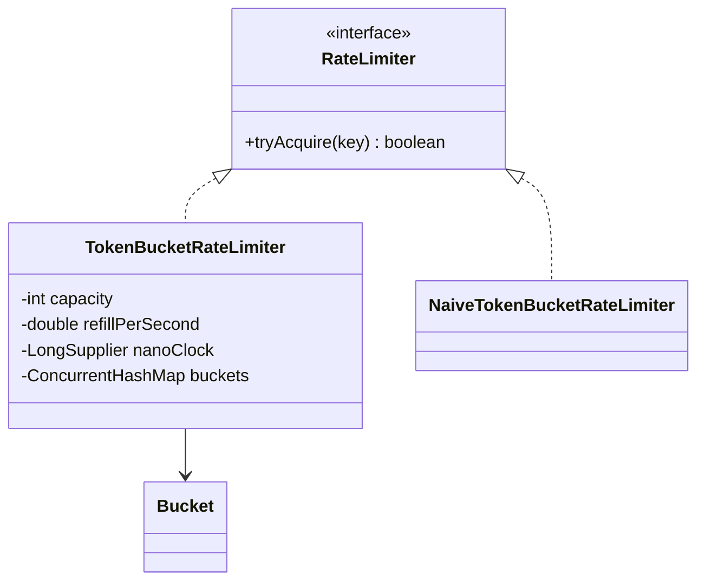

# Rate Limiter (Token Bucket)

> Allow at most N calls per key, with a steady refill, and stay correct when many threads ask at once.

## 1. Problem
- `tryAcquire(key)` answers allowed or rejected immediately; it never blocks.
- Each key (user, IP, API key) has its own limit: a burst up to `capacity`, then `refillPerSecond` on average.
- Must be exact under concurrency: a limit of 100 admits at most 100 calls.
- Out of scope: distributed limiting across servers, persistence, response headers.

## 2. Class diagram


## 3. How it works
A bucket starts full. On each call the limiter works out how much time has passed, adds `elapsed * refillPerSecond` tokens (capped at `capacity`), and if at least one token is available takes it. Buckets are created lazily per key.

The refill is computed on demand from the clock, so no background thread is needed. The clock is a `LongSupplier`, so tests move time by hand and are exact.

## 4. Design decisions
| Decision | Why |
|---|---|
| Lazy refill, no timer thread | No scheduler to manage, and idle keys cost nothing. |
| `ConcurrentHashMap.computeIfAbsent` for buckets | Two threads racing to create a key's bucket still share one. |
| `synchronized` on the bucket | The read-refill-decide-update sequence is atomic per key, while different keys never contend. |
| Injected clock | Deterministic tests without `sleep`. |
| `RateLimiter` interface | Other algorithms (sliding window, fixed window) can replace the bucket. |

## 5. Trade-offs and alternatives rejected
- **Fixed window counter**: simplest, but allows 2x the limit around a window boundary.
- **Sliding window log**: exact, but stores a timestamp per request.
- **Atomics instead of `synchronized`**: possible with a CAS loop over an immutable (tokens, timestamp) pair; more code for the same behaviour at this scale.
- **When NOT to use it:** if you need a hard guarantee across many servers, an in-process limiter is not enough; use a shared store (e.g. Redis) or divide the limit between nodes.

## 6. SOLID notes
**O/D**: callers depend on `RateLimiter`; a new algorithm is a new class. **S**: time handling is injected, not hard-coded.

## 7. Known limitations
- Buckets are never removed, so many distinct keys grow memory without bound (evict idle buckets, or back the map with the [LRU cache](../lrucache/README.md)).
- The naive version has no refill on purpose, so its limit is easy to state.
- Per-process only.

## 8. Interview follow-ups
- Distributed version? Shared counters with atomic Lua scripts, or a per-node share of the limit.
- Different limits per plan? Resolve a config per key and create the bucket from it.
- Return how long to wait (`Retry-After`)? Compute `(1 - tokens) / refillPerSecond`.
- Sliding window? Implement it behind the same interface.

## 9. Related topics
[Concurrency notes](../../../../../docs/concurrency.md), [LRU cache](../lrucache/README.md), [Strategy](../../patterns/strategy/README.md)

## Run it
```
mvn -q exec:java -Dexec.mainClass=problems.ratelimiter.EntryPoint
mvn -q test -Dtest=RateLimiterTest
```
