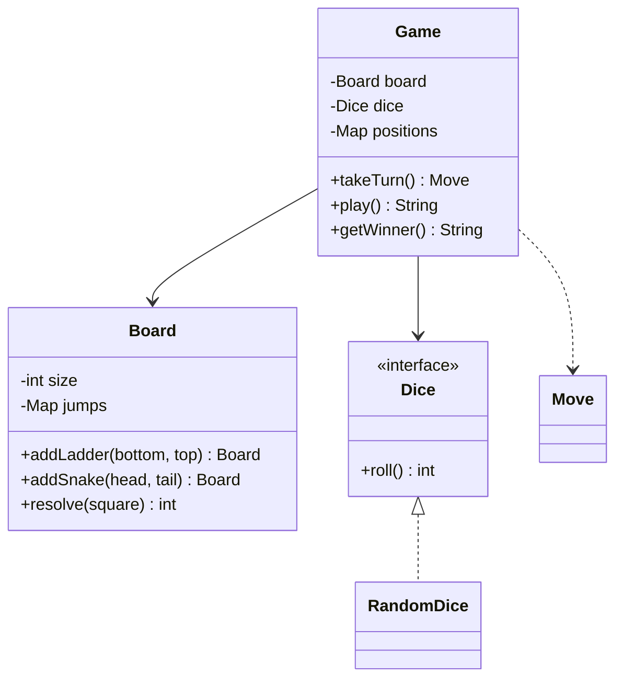

# Snake and Ladder

> A turn-based board game where a die decides movement and snakes and ladders move tokens between squares.

## 1. Problem
- Squares are numbered `1..size` (100 by default); tokens start off the board.
- Players take turns rolling a die and moving forward by the roll.
- Landing on the bottom of a ladder moves you up; on a snake's head, down.
- You must land **exactly** on the last square to win; a roll that would overshoot leaves you in place.
- Snakes and ladders must be valid: a ladder goes up, a snake goes down, none start on the last square, and jumps never chain.
- Out of scope: extra turns on a six, multiple dice, a UI.

## 2. Class diagram


## 3. How it works
`takeTurn()` rolls the die for the current player, adds it to their position, and if that overshoots the board the player stays put. Otherwise `Board.resolve(square)` applies a snake or ladder if there is one. If the result is the last square, that player is the winner. The turn then passes on. `play()` simply repeats `takeTurn()` until there is a winner.

## 4. Design decisions
| Decision | Why |
|---|---|
| `Dice` interface | Tests script exact rolls; production uses `RandomDice` with a seedable `Random`. |
| Snakes and ladders as one `jumps` map | Both are "land here, end up there"; the direction rule is only a validation. |
| Validation when building the board | An invalid board can't exist, so the game loop has no special cases. |
| `takeTurn()` returns a `Move` record | A UI can narrate the game and tests can assert on whole turns. |
| Fluent `addLadder`/`addSnake` | A board reads like its definition. |

## 5. Trade-offs and alternatives rejected
- **A 2D array of squares** with a `Cell` type is natural if cells need behaviour (traps, bonuses); with plain jumps a map is simpler.
- **Allowing chains** (a ladder landing on a snake head) is possible but makes termination harder to reason about, so it is rejected up front.
- **When NOT to add more abstraction:** a `Player` class and a `Cell` hierarchy would be over-engineering for these rules.

## 6. SOLID notes
**S** (board rules, dice and game flow are separate), **O** (new dice types need no game changes), **D** (the game depends on `Dice`).

## 7. Known limitations
- Players are plain strings; duplicate names would share a position.
- No extra turn on a six.
- No limit on how long `play()` runs if the dice never produce the exact finishing roll (a seeded `RandomDice` always terminates in practice).

## 8. Interview follow-ups
- Extra turn on rolling a six? Loop in `takeTurn()` while the roll is 6 (cap it at three).
- Two dice or a loaded die? A new `Dice` implementation.
- Different winning rule (overshoot bounces back)? Change one expression in `takeTurn()`.
- Game history and replay? Keep the list of `Move`s.

## 9. Related topics
[Tic-Tac-Toe](../tictactoe/README.md), [Strategy](../../patterns/strategy/README.md)

## Run it
```
mvn -q exec:java -Dexec.mainClass=problems.snakeandladder.EntryPoint
mvn -q test -Dtest=GameTest
```
