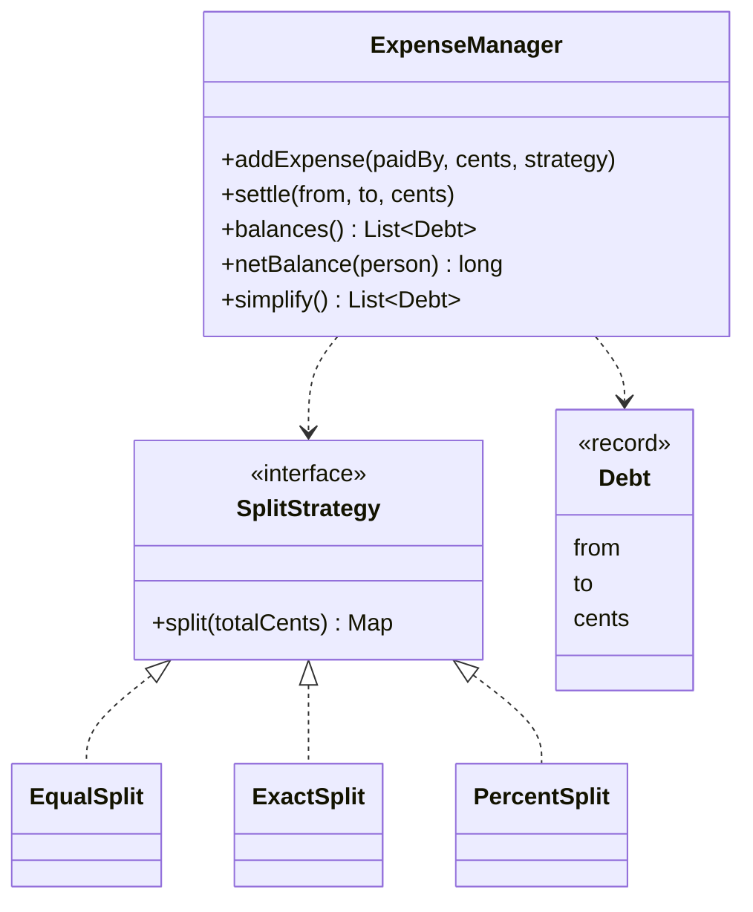

# Splitwise (Expense Sharing)

> Track who paid for what, split it three ways, and work out who owes whom, including the fewest payments to settle up.

## 1. Problem
- Someone pays an expense and it is split among participants **equally**, by **exact amounts** or by **percentages**.
- The system keeps running balances between people. Debts between the same two people net out.
- Anyone can settle part or all of a debt.
- It can propose the smallest practical set of payments that clears every balance.
- Out of scope: groups, currencies, expense history and edits, authentication.

## 2. Class diagram


## 3. How it works
`addExpense` asks the `SplitStrategy` for each person's share, checks that the shares are non-negative and add up to the total, then records every non-payer's share as a debt to the payer. Debts are stored per ordered pair and **netted on write**: adding "A owes B 50" when "B owes A 100" leaves "B owes A 50". `settle` is simply the opposite debt, so it uses the same netting.

`simplify()` computes each person's net balance, then repeatedly makes the largest debtor pay the largest creditor, which gives at most (people - 1) payments.

## 4. Design decisions
| Decision | Why |
|---|---|
| [Strategy](../../patterns/strategy/README.md) for splitting | The three split types differ only in how shares are computed. |
| Money as integer cents | No rounding drift: shares always sum to the total exactly. |
| Remainder cents go to the first people (equal) or first person (percent) | Deterministic, and the total is never off by a cent. |
| Net on write | Balances stay small and `balances()` never shows both directions. |
| Settling = opposite debt | One code path, one place to get the netting right. |
| Manager re-validates the strategy's output | A buggy custom strategy cannot corrupt the books. |

## 5. Trade-offs and alternatives rejected
- **Storing every expense** and computing balances on read keeps full history and allows edits and undo, at the cost of recomputing. Netting on write is the simpler, faster model here.
- **Greedy simplification** gives at most n-1 payments but not always the true minimum. Finding the minimum is NP-hard (it is a subset-sum partition problem).
- **When NOT to use Strategy for splits:** with a single split type, a plain method is enough.

## 6. SOLID notes
**O** (a new split type is a new class), **S** (split rules vs bookkeeping), **D** (the manager depends on `SplitStrategy`).

## 7. Known limitations
- Settling exactly follows direct debts; the suggestions from `simplify()` are advice and are not applied to the books.
- No history: you cannot see or undo an individual expense.
- Not thread-safe.
- People are identified by plain strings.

## 8. Interview follow-ups
- Groups and per-group balances? One `ExpenseManager` per group.
- Multiple currencies? A `Money` type, with conversion at the edges.
- Edit or delete an expense? Keep the expense list and recompute (or apply the reverse debts).
- Fewest transactions, exactly? Discuss the NP-hard partition problem and when greedy is good enough.
- Concurrent users? Lock per group, or serialise writes through a queue.

## 9. Related topics
[Strategy](../../patterns/strategy/README.md), [Concurrency notes](../../../../../docs/concurrency.md)

## Run it
```
mvn -q exec:java -Dexec.mainClass=problems.splitwise.EntryPoint
mvn -q test -Dtest=ExpenseManagerTest
```
