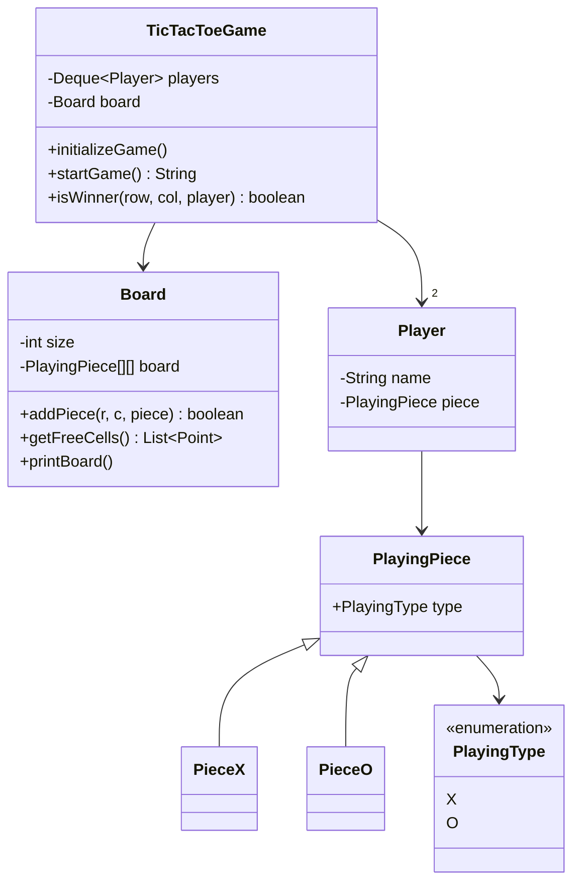

# Tic-Tac-Toe

> A two-player console game on an N×N board; the reference example for how every topic in this repo is documented.

## 1. Problem
- Two players alternate placing X and O on a square board (3×3 by default).
- A move is rejected if the cell is taken or outside the board; the same player retries.
- The first player to fill a row, column or either diagonal wins; a full board with no winner is a tie.
- Input is `row col` or `row,col`.
- Out of scope: AI opponent, undo, networking.

## 2. Class diagram


## 3. How it works
`TicTacToeGame.initializeGame()` creates two players and a board. `startGame()`
loops: take the next player from the front of a `Deque`, read a move, ask the
`Board` to place the piece, and on success check `isWinner` for just the row,
column and diagonals through the cell that was played. A legal move sends the
player to the back of the queue; an illegal one puts them back at the front.

## 4. Design decisions
| Decision | Why |
|---|---|
| `Deque<Player>` for turn order | Turn rotation and "retry" are just `addLast` / `addFirst`; no index arithmetic and it supports more than two players. |
| `Board` owns the grid and placement rules | The game class never touches cell arrays when validating a move. |
| `PlayingPiece` hierarchy plus `PlayingType` enum | Pieces are open for extension (a new symbol is one subclass) without changing the board. |
| Win check only looks through the last move | O(N) per move instead of scanning the whole board. |

## 5. Trade-offs and alternatives rejected
- **Piece subclasses vs. a plain enum.** Subclasses are heavier than needed for X/O; they pay off only if pieces gain behaviour.
- **Counters per row/column/diagonal** would make the win check O(1) per move, at the cost of extra state to keep consistent.
- Win logic lives in `TicTacToeGame`; moving it to `Board` would make the game class thinner and the rules easier to test in isolation.

## 6. SOLID notes
- **S**: the board knows placement, the game knows turns and winning. Win detection inside the game is the weakest split.
- **O**: new piece types need no board changes.
- **D**: the game depends on `PlayingPiece`, not on X or O.

## 7. Known limitations
- Input parsing does not guard against non-numeric text or a single number, and `Board.addPiece` does not reject negative indices; either throws instead of reporting an illegal move.
- A new `Scanner` is created on every turn.
- Console I/O is mixed into `startGame()`, so it is not unit-tested; the board and win detection are (see `BoardTest`, `TicTacToeGameTest`).
- "Play again" in `EntryPoint` reuses the same `TicTacToeGame` without calling `initializeGame()` again, so the board is not cleared and the winner is not returned to the turn queue.
- `isWinner` compares piece instances by reference, which works because each player owns a single piece object.

## 8. Interview follow-ups
- **Bigger board / K in a row?** `Board` already takes a size; change the win check to count a run of K.
- **Play against a computer?** Extract a `MoveSource` interface (console, AI) so `startGame()` stops reading `System.in` directly.
- **Undo?** Keep a stack of moves (Command pattern).
- **More than two players?** The deque already rotates any number of players.
- **Make the win check O(1)?** Maintain row, column and diagonal counters.

## 9. Related topics
- [Strategy](../../patterns/strategy/README.md) for pluggable move sources
- [Logger](../logger/README.md)

## Run it
```
mvn -q exec:java -Dexec.mainClass=problems.tictactoe.EntryPoint
mvn -q test -Dtest='BoardTest,TicTacToeGameTest'
```
