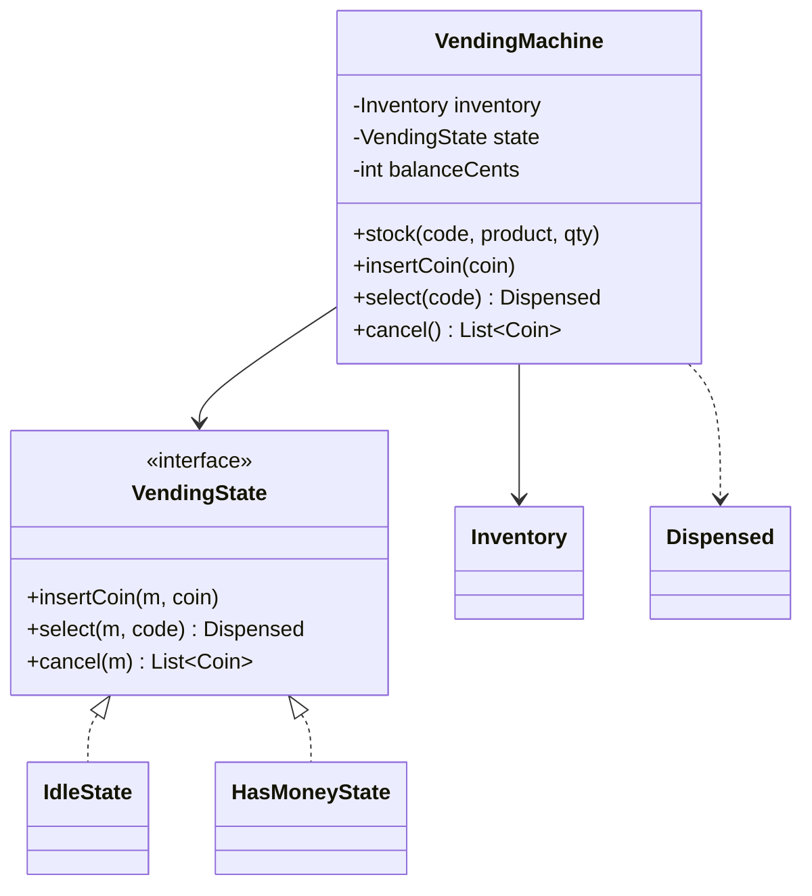

# Vending Machine

> Accept coins, dispense a product and make change, with each action only legal in the right state.

## 1. Problem
- Stock products in coded slots (`A1`) with a price and a quantity.
- Insert coins (nickel, dime, quarter, dollar); the balance accumulates.
- `select(code)` dispenses the product and change when enough money is in; otherwise it fails and **keeps** the money.
- `cancel()` refunds everything.
- Selecting with no money, an unknown code or a sold-out slot is an error.
- Out of scope: card payments, a coin float that can run out, restocking while a customer is mid-purchase.

## 2. Class diagram


## 3. How it works
The machine starts in `IdleState`. Inserting a coin adds to the balance and moves it to `HasMoneyState`. In that state `select` checks, in order, that the code exists, the slot has stock and the balance covers the price; it only then takes one item, computes change greedily (largest coin first), clears the balance and returns to idle. Any failed check throws before anything is changed, so the customer can top up or pick again. `cancel` refunds the balance and returns to idle.

## 4. Design decisions
| Decision | Why |
|---|---|
| [State pattern](../../patterns/state/README.md) | "Select" means different things with and without money; the `if (balance > 0)` checks live in the states instead. |
| Validate first, mutate last | A failed selection leaves the machine exactly as it was. |
| Money as integer cents | No floating-point rounding in prices or change. |
| States get the machine as an argument | States hold no data, so they could be shared singletons. |
| `Inventory` is package-private | Only the machine changes stock. |

## 5. Trade-offs and alternatives rejected
- **An enum state with `switch`** is fine for two states, and shorter. The State pattern pays off as states are added (out of service, maintenance, dispensing).
- **Greedy change** is correct for these denominations; for arbitrary coin systems it needs dynamic programming.
- **When NOT to use State here:** if the machine will only ever have "has money / doesn't", a boolean is enough.

## 6. SOLID notes
**O** (a new state is a new class), **S** (inventory, change and state are separate), **D** (the machine depends on `VendingState`).

## 7. Known limitations
- Assumes unlimited coins for change; the machine never refuses a sale because it can't give change.
- Not thread-safe; a real machine has one customer at a time.
- Stocking an existing code ignores a different product or price passed the second time.

## 8. Interview follow-ups
- Limited coin float? Track coins per denomination and refuse the sale (or ask for exact change) when change can't be made.
- Maintenance mode? Add an `OutOfServiceState` that rejects coins.
- Card payments? A `PaymentMethod` interface (Strategy) instead of coins only.
- Timeouts that auto-refund? A scheduler calling `cancel()`.

## 9. Related topics
[State](../../patterns/state/README.md), [Strategy](../../patterns/strategy/README.md)

## Run it
```
mvn -q exec:java -Dexec.mainClass=problems.vendingmachine.EntryPoint
mvn -q test -Dtest=VendingMachineTest
```
